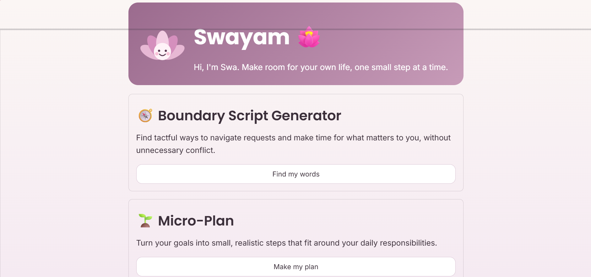
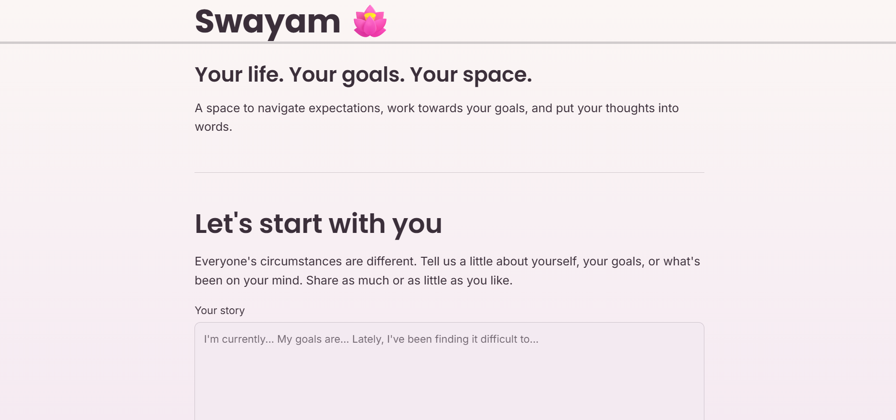
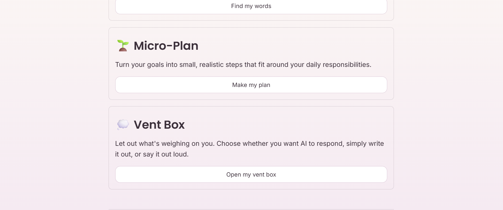
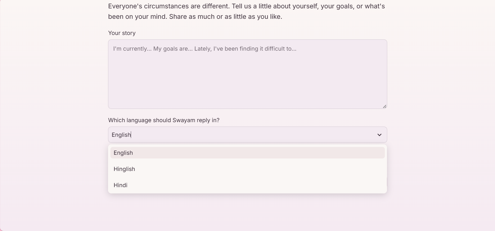
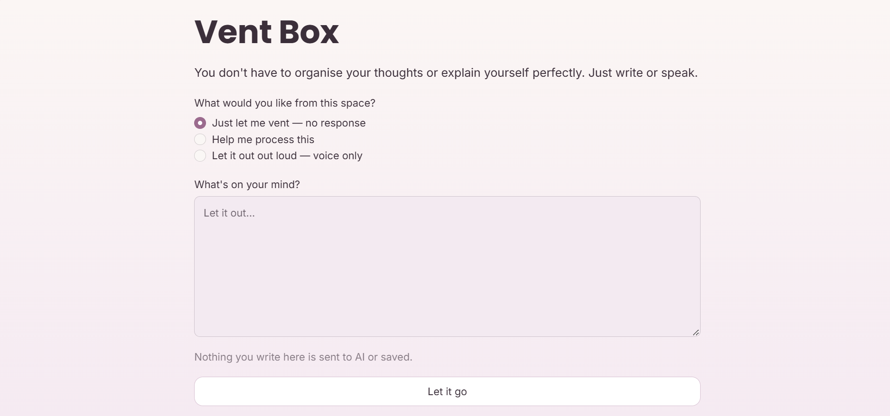

<div align="center">

# 🪷 Swayam

**Your life. Your goals. Your space.**  
*An AI-powered support companion for young women in Indian households navigating family expectations, daily boundaries, and personal ambitions.*

[](https://www.python.org/)
[](https://streamlit.io/)
[](https://ai.google.dev/)
[](./app.py)
[](https://hack2skill.com/event/promptwars-x-aivibeathon2026/dashboard/submissions)

</div>

---

## ✨ Overview

**Swayam** (*"Swa"*) is a calm, culturally grounded web space designed for young women in Indian households who are trying to balance family expectations, household responsibilities, and social norms alongside their own studies, career goals, and inner peace.

Instead of pushing rigid hustle culture or confrontational advice that ignores real family dynamics, Swayam offers practical words, realistic micro-plans, and a private place to breathe—all without logins, accounts, or backend databases.

<div align="center">
  
</div>

---

## 🌸 Core Features

* **🧭 Boundary Script Generator**  
  Tailors realistic, respectful scripts based on *who* is asking (mother, father, relatives, in-laws, siblings, or others), the tone you want to strike, and how urgent your own work is.

* **🌱 Micro-Plan**  
  Turns personal or academic goals into guilt-free daily blocks around your peak energy window, existing responsibilities, deadlines, and common roadblocks—with one-click `.txt` export.

* **💭 Multi-Mode Vent Box**  
  * **Just let me vent:** Ephemeral writing space with a **"Let it go"** button that wipes everything clean without sending it to AI or saving it.  
  * **Let it out out loud (Voice Vent):** Browser-only voice recording (`st.audio_input`) to speak or shout it out privately and clear it immediately.  
  * **Help me process this:** Gentle AI reflection that separates outside expectations from what truly matters to you.

* **🌐 Multilingual & Culturally Grounded**  
  Responds naturally in **English**, **Hinglish**, or **Hindi**, with built-in safety prompts surfacing **Women Helpline 181** and **Tele-MANAS 14416** when needed.

---

## 📸 App Preview

| Dashboard & Overview | Tools & Vent Box |
| :---: | :---: |
|  |  |
|  |  |

---

## 🛠️ Tech Stack

* **Interface & Styling:** Streamlit, custom CSS (mauve & cream theme), inline SVG lotus mascot
* **AI & Prompt Engineering:** Google Gemini API (`google-genai`) with multi-model fallback and structured task prompts (`CORE_PHILOSOPHY`, `BOUNDARY_PROMPT`, `PLAN_PROMPT`, `PROCESS_PROMPT`)
* **Privacy Architecture:** Ephemeral `st.session_state` & local browser storage—no database, no user tracking

---

## 📁 Project Structure

```text
swayam/
├── .streamlit/
│   ├── config.toml          # Streamlit theme & configuration
│   └── secrets.toml         # Local Gemini API key (not committed)
├── screenshots/
│   ├── dashboard_home.png   # Home banner & intro view
│   ├── dashboard.png        # Main dashboard view
│   ├── dashboard2.png       # Secondary dashboard view
│   ├── tools.png            # Boundary Script & Micro-Plan tools
│   └── ventbox.png          # Ephemeral & voice Vent Box
├── app.py                   # Main Streamlit application
├── requirements.txt         # Python dependencies
└── README.md                # Project documentation